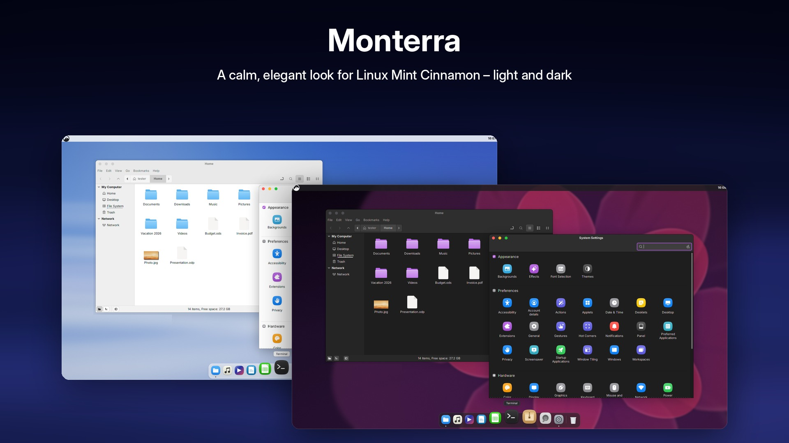
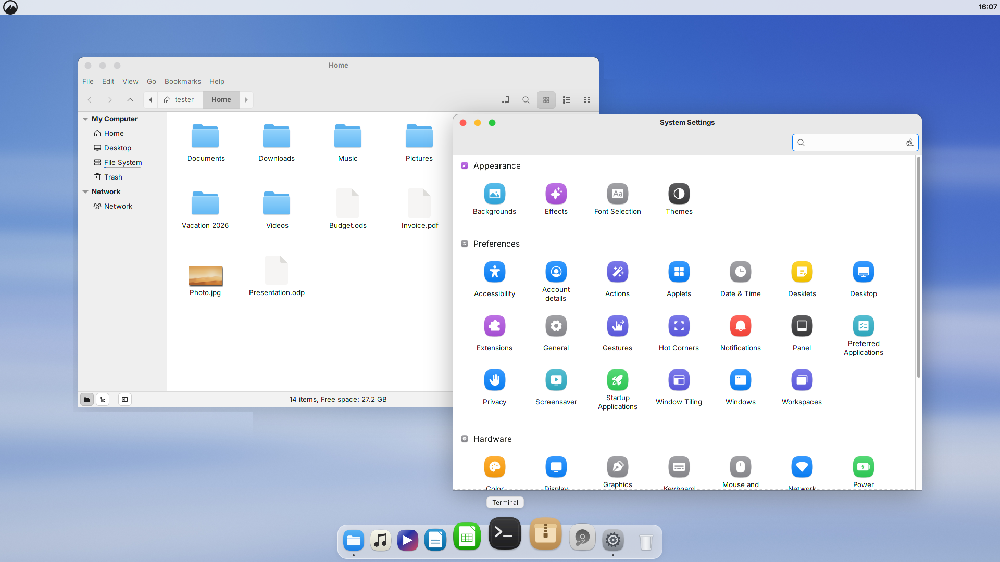
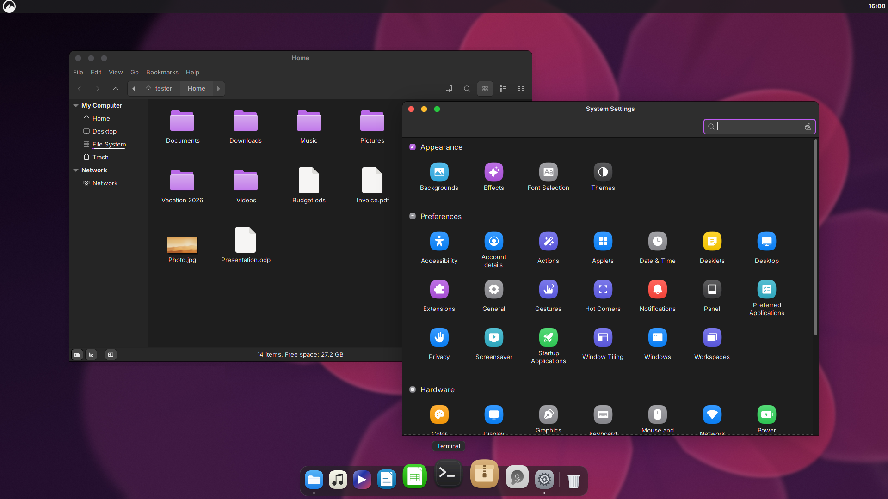
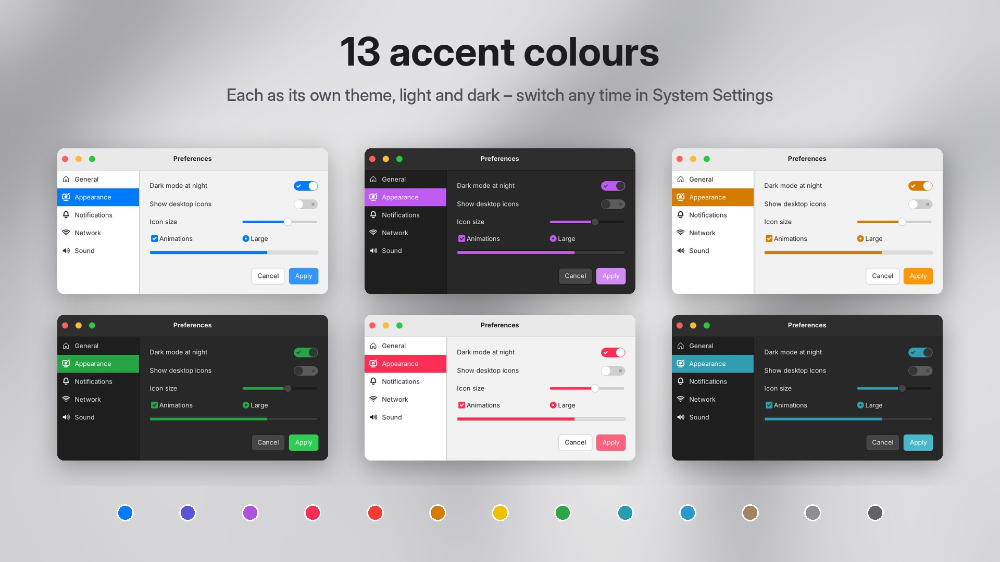
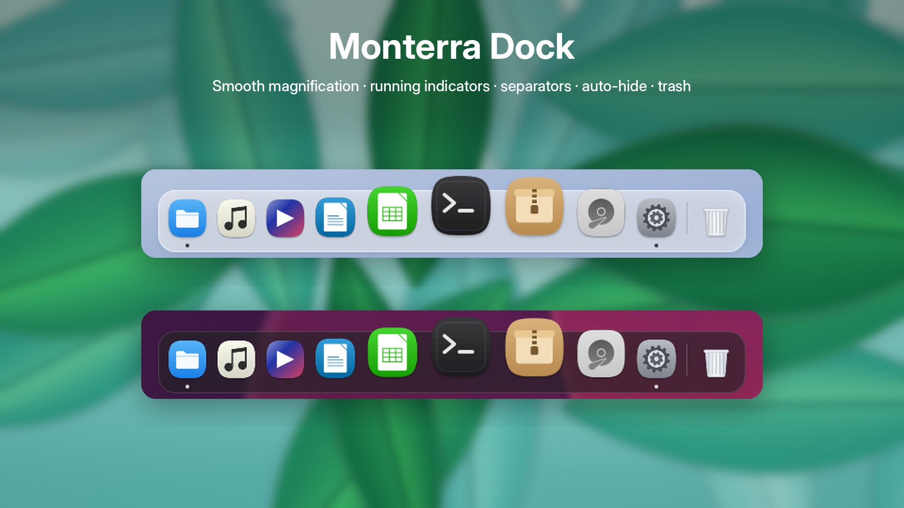
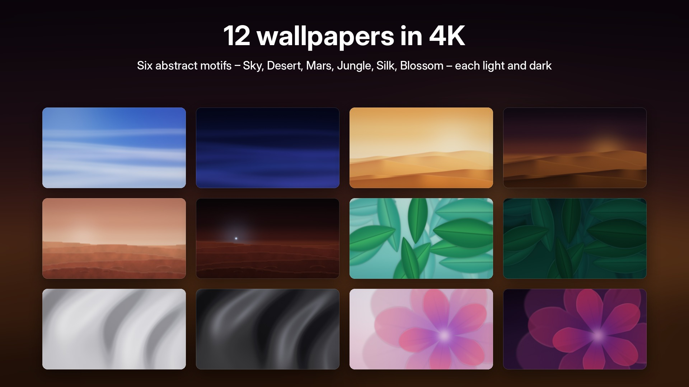
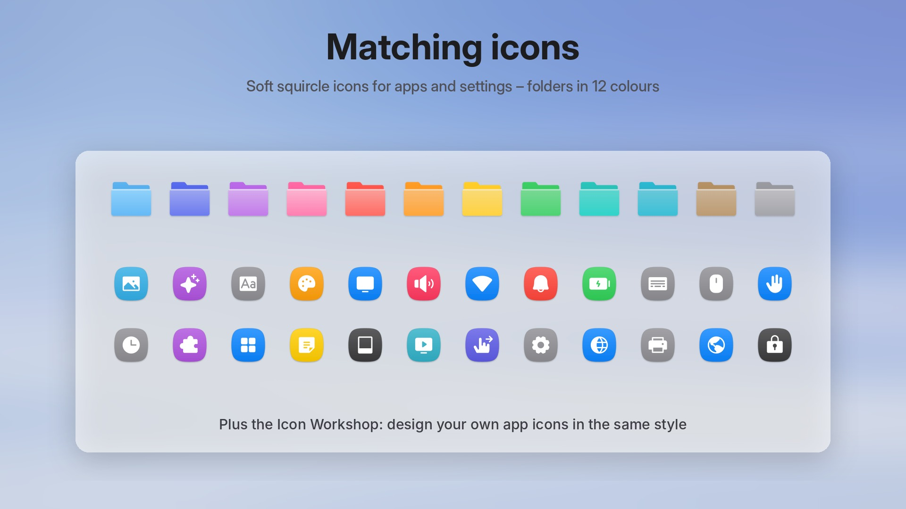

# Monterra – ein eleganter Desktop-Look für Linux Mint (Cinnamon)

> **English / Español:** Start `bash setup.sh` – the installer asks for your language first (Deutsch · English · Español). / El instalador pregunta primero el idioma.

Monterra verwandelt Linux Mint 22.3 (Cinnamon 6.6, vorbereitet für Mint 23 / Cinnamon 6.8) in einen ruhigen, aufgeräumten Desktop mit Dock, Ampel-Fensterknöpfen und weichen Formen – in **Hell** und **Dunkel**. Vorschaubilder liegen im Ordner `previews/`.



## Installation

Im entpackten Ordner ein Terminal öffnen und starten (ohne `sudo`):

```bash
bash setup.sh
```

Der Installer fragt in kleinen Fenstern, was du möchtest, zeigt eine Zusammenfassung und richtet dann alles ein:

| Frage | Auswahl |
|---|---|
| Sprache | Deutsch · English · Español |
| Was möchtest du tun? | installieren/aktualisieren · **alles rückgängig machen** |
| Variante | Hell · Dunkel |
| Panels & Dock | Menüleiste oben + Monterra Dock · Menüleiste oben + Panel unten · nur Monterra Dock · nichts ändern |
| Hintergrund (mit Vorschaubildern) | Himmel · Wüste · Mars · Dschungel · Seidentuch · Blüte · nicht ändern |
| Akzentfarbe (mit Vorschaubildern) | passend zum Hintergrund · eine der 13 Systemfarben |
| Fensterknöpfe | Schieberegler 14–32 px in 2er-Schritten (Standard 16 px) |
| Weitere Bestandteile | Schrift Inter 🔒 · Programm- und Web-App-Symbole · Automatik für neue Programme · Symbolwerkstatt · Fenstergröße merken · Weiche Fensterschatten (optional, vorab aus) · Firefox-Look · Thunderbird-Look · Ordnerfarben 🔒 · Boot-Splash 🔒 · Anmeldebildschirm 🔒 |

🔒 = braucht einmal dein Passwort. Bisherige Einstellungen werden vorher gesichert; **„Monterra vollständig entfernen“** im selben Installer stellt alles wieder her. Der Installer kann beliebig oft gestartet werden (z. B. um von Hell auf Dunkel zu wechseln). Der Installer öffnet einen Assistenten im Monterra-Stil mit Vorschaubildern; einzelne Fenster wie früher: `bash setup.sh --classic` · Fragen im Terminal: `bash setup.sh --text` · Sprache vorwählen: `--lang=de|en|es` · Protokoll: `~/monterra-installer.log`

## Was enthalten ist

- **Themes** „Monterra“ / „Monterra-Dark“: klare, helle bzw. tiefgraue Farben, runde Ecken, Ampel-Knöpfe links, Menüleiste oben – für GTK 2/3/4, Cinnamon und libadwaita
- **Akzentfarbe** in 13 Systemfarben: färbt Knöpfe, Markierungen, Schalter, Fortschrittsbalken, Menüs und die Ordnersymbole. Gelb bekommt dunkle Schrift, helle Farben sind für gute Lesbarkeit leicht abgedunkelt. Jede Farbe ist ein eigenes Theme („Monterra-Gruen“, „Monterra-Dark-Gruen“ …; „Monterra“ und „Monterra-Dark“ sind Blau) und lässt sich jederzeit unter **Systemeinstellungen → Themen → Anwendungen** wechseln – Desktop, Fensterrahmen, Ordnerfarbe, Firefox und Thunderbird ziehen von selbst mit.
- **Fenster:** Ampel-Knöpfe (das Symbol erscheint beim Darüberfahren), abgerundete Ecken. Programme mit eigener Titelleiste (GTK 3/4) sind rundum rund; bei Fenstern mit Systemrahmen (z. B. Nemo) rundet Cinnamon die oberen Ecken – unten bleibt der Fensterinhalt eckig, das gibt Cinnamon so vor. Maximierte, angedockte und Vollbild-Fenster bleiben eckig. Optional gibt die Erweiterung „Monterra Fensterschatten“ auch Fenstern mit Systemrahmen die großen, weichen Schatten, die das Theme den übrigen Programmen gibt (im Installer vorab ausgeschaltet; ohne sie gelten Mints Standardschatten).
- **Systemeinstellungen:** Die Symbole der Übersicht stehen in allen Gruppen sauber untereinander (kleiner Starter in `~/.local/bin`, Cinnamon selbst bleibt unverändert; wirksam nach der nächsten Anmeldung).
- **Fenstergröße merken:** Cinnamon selbst merkt sich nicht, wie groß ein Fenster zuletzt war. Die Erweiterung „Monterra Fenstergröße“ speichert für jedes Programm Größe, Position und „maximiert“ und stellt sie beim nächsten Öffnen wieder her (Dialoge ausgenommen; ein zweites Fenster desselben Programms bekommt nur die Größe).
- **Mitteilungen** als schwebende, abgerundete Karten; **Fensterwechsler (Alt+Tab)** als Reihe großer Symbole auf Milchglas, nur das gewählte Programm zeigt seinen Namen
- **Sperrbildschirm:** große Uhr mit Datum, rundes Passwortfeld und runde Knöpfe auf Milchglas
- **Symbole** „Monterra“: blaue Ordner, Squircle-Programmsymbole, Systemeinstellungen- und Menüleisten-Symbole, 12 Ordnerfarben; **Mauszeiger** „Monterra-Cursor“
- **Monterra Menüleiste**: Leiste oben mit Logo-Menü (Suche, Über diesen Computer, Systemeinstellungen, Menü bearbeiten, Bereitschaft, Neu starten, Ausschalten, Abmelden) und je App-Kategorie einem Aufklappmenü, das beim Darüberfahren öffnet; die Super-Taste öffnet die Suche. Rechtsklick auf eine App → „Dem Dock hinzufügen“ oder „Eigenschaften“. Kategorien ändern, anlegen und löschen: Logo-Menü → „Menü bearbeiten …“.
- **Monterra Dock**: schlankes Dock als Cinnamon-Erweiterung – flüssige Vergrößerung, Drag-and-Drop (auch aus dem Menü), frei platzierbare Trenner, Papierkorb, automatisches Ausblenden. **Trenner:** Rechtsklick auf ein angeheftetes Programm → „Trenner links/rechts einfügen“; verschieben per Drag-and-Drop; entfernen per Rechtsklick auf den Trenner.
- **Hintergründe in 4K**, abstrakt und ruhig, je hell und dunkel: **Himmel** (Blau, Indigo), **Wüste** (Orange, Gelb), **Mars** (Rot, Braun), **Dschungel** (Grün, Petrol, Cyan), **Seidentuch** (Grau, Graphit), **Blüte** (Lila, Pink)
- **Boot-Splash**, **Anmeldebildschirm** (zeigt den gewählten Hintergrund weichgezeichnet), **Firefox-Look** (schlicht, mit Ampel-Knöpfen), **Thunderbird-Look** (ruhige Grautöne, Seitenleiste), **Programm- und Web-App-Symbole** im einheitlichen Monterra-Stil

<p>
  
  
</p>






## Ordnerübersicht

```
setup.sh       geführte Installation und Deinstallation – der einzige Einstieg
themes/        Monterra und Monterra-Dark (→ ~/.themes), accents/ = Abweichungen je Akzentfarbe
icons/         Symbole, Mauszeiger, Ordnerfarben (→ ~/.icons)
wallpapers/    12 Hintergrundbilder 3840 × 2160 (6 Motive × hell/dunkel) – landen bei der Installation in „Bilder/Monterra Wallpaper“
components/    Dock, Fensterschatten, Fenstergröße, Firefox- und Thunderbird-Look, Boot-Splash, Anmeldebildschirm, Ordnerfarben, Symbolwerkstatt
tools/         Einzelskripte (werden vom Installer aufgerufen, auch einzeln nutzbar); languages/ = Texte des Installers
my-icons/      hier eigene Symbole für andere Rechner ablegen (siehe Symbolwerkstatt)
previews/      Bildschirmfotos; picker/ = Vorschaubilder für den Installer
source/        nur zum Selbst-Bauen, für die Installation nicht nötig
```

Alle Datei- und Ordnernamen sind englisch, damit sich auch Nutzerinnen und Nutzer ohne Deutschkenntnisse zurechtfinden.
Die Hintergründe heißen z. B. `Monterra-Sky-Light.jpg` (Himmel, hell) oder `Monterra-Desert-Dark.jpg` (Wüste, dunkel),
die Akzent-Themes z. B. `Monterra-Green` und `Monterra-Dark-Green`. Wer eine frühere Version mit deutschen Namen
installiert hat, startet einfach `bash setup.sh` erneut – eingestellter Hintergrund und Akzentfarbe werden übernommen.

## Manuell installieren (ohne Installer)

```bash
mkdir -p ~/.themes ~/.icons
cp -r themes/Monterra themes/Monterra-Dark ~/.themes/
cp -r icons/* ~/.icons/
```

Das ergibt die blaue Akzentfarbe. Alle 13 Farben als eigene Themes (und den automatischen Abgleich) richtet `bash tools/accent-color.sh green` ein (deutsche Farbnamen wie `gruen` gehen ebenfalls).

Dann unter **Systemeinstellungen → Themen**: Fensterrahmen, Steuerelemente und Desktop „Monterra“ (oder „Monterra-Dark“), Symbole „Monterra“, Mauszeiger „Monterra-Cursor“. Fensterknöpfe links in der Reihenfolge Schließen, Minimieren, Maximieren:

```bash
gsettings set org.cinnamon.desktop.wm.preferences button-layout 'close,minimize,maximize:'
```

## Einzelne Teile per Werkzeug

Alle Skripte im entpackten Ordner aufrufen, ohne `sudo` (sie fragen bei Bedarf selbst nach dem Passwort). Jedes kennt `--remove` bzw. `restore` zum Rückgängigmachen.

| Aufgabe | Befehl |
|---|---|
| Theme, Symbole, Schrift, Knöpfe links aktivieren | `bash tools/setup.sh [--dark] [--layout] [--motif=desert\|--keep-wallpaper] [--accent=green]` |
| Akzentfarbe wechseln (auch Ordner, Firefox, Thunderbird) | Systemeinstellungen → Themen → Anwendungen, oder `bash tools/accent-color.sh green` |
| Monterra Menüleiste einrichten/aktualisieren · entfernen | `bash tools/menubar.sh` · `bash tools/menubar.sh --remove` |
| Monterra Dock (optional unteres Panel entfernen) | `bash tools/dock.sh [--no-panel]` |
| Systemeinstellungen: Symbole gleichmäßig ausrichten | `bash tools/settings-grid.sh` / `--remove` |
| Fenstergröße merken ein/aus | `bash tools/window-size.sh` / `bash tools/window-size.sh --remove` |
| Weiche Fensterschatten ein/aus | `bash tools/window-shadows.sh` / `bash tools/window-shadows.sh --remove` |
| Größe der Fensterknöpfe (14–32 px, gerade Zahlen) | `bash tools/window-buttons.sh 22` |
| Firefox-Look (danach Firefox neu starten) | `bash tools/firefox.sh [--keep-titlebar]` |
| Thunderbird-Look (danach Thunderbird neu starten) | `bash tools/thunderbird.sh [--keep-titlebar]` |
| Ordnerfarben im Nemo-Kontextmenü | `bash tools/folder-colors.sh` |
| Boot-Splash | `bash tools/bootsplash.sh [--light]` |
| Anmeldebildschirm (weichgezeichneter Hintergrund) | `bash tools/login-screen.sh [--motif desert] [--day]` |
| Programmsymbole vereinheitlichen | `python3 tools/app_icons.py preview\|apply\|restore` |
| Web-App-Symbole | `python3 tools/webapps.py apply\|restore` |
| Symbolwerkstatt (eigene Symbole gestalten) | `python3 tools/icon_workshop.py [--install\|--remove\|--export DATEI\|--import DATEI\|--repair]` |
| Automatik: neue Programme selbst anpassen | `bash tools/auto-icons.sh [--remove\|--status]` |

## Auf weiteren Rechnern installieren

ZIP übertragen, entpacken, `bash setup.sh` starten und bei „Weitere Bestandteile“ **Programm- und Web-App-Symbole** und die **Automatik** anhaken. Die Programmsymbole werden auf jedem Rechner passend zu den dort installierten Programmen erzeugt.

Die **Automatik** sorgt dafür, dass es einheitlich bleibt: Wird später ein Programm (apt, Flatpak, Snap) oder eine Web-App installiert, bekommt es kurz danach von selbst ein Symbol in Monterra-Form – mit einer kleinen Benachrichtigung. Zusätzlich wird bei jeder Anmeldung geprüft. Im Leerlauf läuft nichts; bereits angepasste Programme werden nicht erneut bearbeitet. Sie arbeitet mit einer eigenen Kopie unter `~/.local/share/monterra`, der entpackte Ordner wird dafür nicht gebraucht. Protokoll: `bash tools/auto-icons.sh --status`.

## Symbolwerkstatt – eigene Programmsymbole gestalten

Ein kleines Programm (im Menü unter **Grafik → Symbolwerkstatt**), das Symbole im Stil der Monterra-Systemeinstellungen erzeugt: weißes Symbol auf farbiger, abgerundeter Fläche.

- **Sprache:** Deutsch, Englisch oder Spanisch – wie im Installer gewählt, sonst wie das System. Umschalten: `python3 tools/icon_workshop.py --lang=en` (bzw. `de`, `es`).
- **Aus Stichwort:** Begriffe auf Deutsch, Englisch oder Spanisch eingeben („Kamera“, „camera“, „cámara“, auch mehrere mit Komma) und aus über 1500 passenden Symbolen wählen.
- **Aus Bild:** eine Vorlage laden (PNG, JPG, SVG …) – daraus wird automatisch eine weiße Silhouette. „Erkennung“, „Schwelle“ und „Umkehren“ helfen bei schwierigen Bildern.
- **Farbe** aus den 13 Systemfarben oder frei wählen, **Symbolgröße** per Regler. Die Vorschau zeigt alle Größen auf hellem und dunklem Grund.
- **Speichern** als PNG (512 × 512) oder SVG – oder mit **„Für Programm verwenden …“** direkt einem installierten Programm zuweisen. So gestaltete Symbole werden von der Automatik und von `app_icons.py` nie überschrieben; `app_icons.py restore` setzt alles zurück.

### Eigene Symbole auf andere Rechner mitnehmen

1. In der Symbolwerkstatt **Datei → „Eigene Programmsymbole exportieren …“** wählen. So entsteht eine Datei `*.monterra-symbole.zip`. Sie enthält alle selbst gestalteten Symbole und die Angabe, zu welchem Programm sie gehören.
2. Die Datei in den Ordner **`my-icons`** des Monterra-Pakets legen und das Paket auf den anderen Rechner kopieren.
3. Dort `bash setup.sh` starten – die Symbole werden automatisch übernommen. Alternativ in der Symbolwerkstatt **„Importieren …“** oder `python3 tools/icon_workshop.py --import DATEI`.

Ist ein Programm auf dem anderen Rechner noch nicht installiert, liegt sein Symbol schon bereit. Ist die Automatik eingeschaltet, bekommt das Programm sein Symbol direkt nach der Installation.

## Tipps

- **4K-Monitor:** Unter *Systemeinstellungen → Anzeige* den Monitor wählen und die Skalierung der Benutzeroberfläche auf **200 %** stellen – dann passt alles inklusive Fensterknöpfen. Ohne Skalierung die Fensterknöpfe auf etwa 22–28 px stellen und die Mauszeigergröße auf 48.
- **Firefox und Thunderbird:** Der Look wirkt mit dem Theme „System-Theme – automatisch“ (Standard). Ein anderes Theme schaltet ihn ab.
- **Akzentfarbe in GNOME-Programmen:** Neuere Programme mit libadwaita übernehmen die Akzentfarbe automatisch über Mints Desktop-Portal.
- **Sperrbildschirm:** Er zeigt deinen Desktop-Hintergrund. Die weichen Motive wirken dort besonders ruhig.
- **Flatpak-Apps** sehen das Theme erst nach einer Freigabe:
  `flatpak override --user --filesystem=~/.themes:ro --filesystem=~/.icons:ro`
- **Dunkle Dialoge im hellen Theme:** Unter *Systemeinstellungen → Themen → Einstellungen* bei „Dunkler Modus“ den hellen Modus bevorzugen.
- Nach Änderungen Cinnamon neu laden: **Alt + F2**, `r`, Enter.

## Lizenz

Monterra ist ein abgeleitetes Werk von **Mint-Y** (© Linux Mint, Clement Lefebvre u. a.) und steht wie dieses unter der **GNU GPL v3 oder neuer** (siehe `LICENSE`). Symbole, Mauszeiger, Fensterknöpfe, Dock und Hintergrundbilder wurden für Monterra neu gestaltet; einige weiße Symbolformen stammen aus [Phosphor Icons](https://phosphoricons.com) (MIT-Lizenz, siehe `source/third_party/phosphor/LICENSE`). Monterra ist ein unabhängiges Gemeinschaftsprojekt und steht in keiner Verbindung zu Linux Mint.
