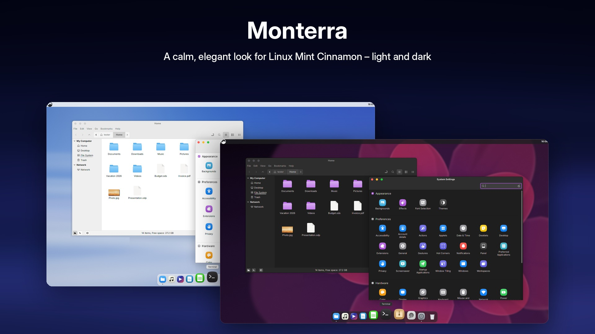
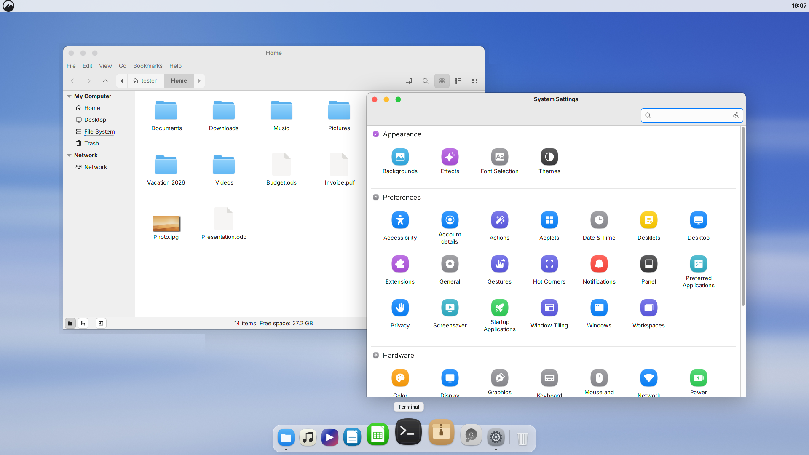
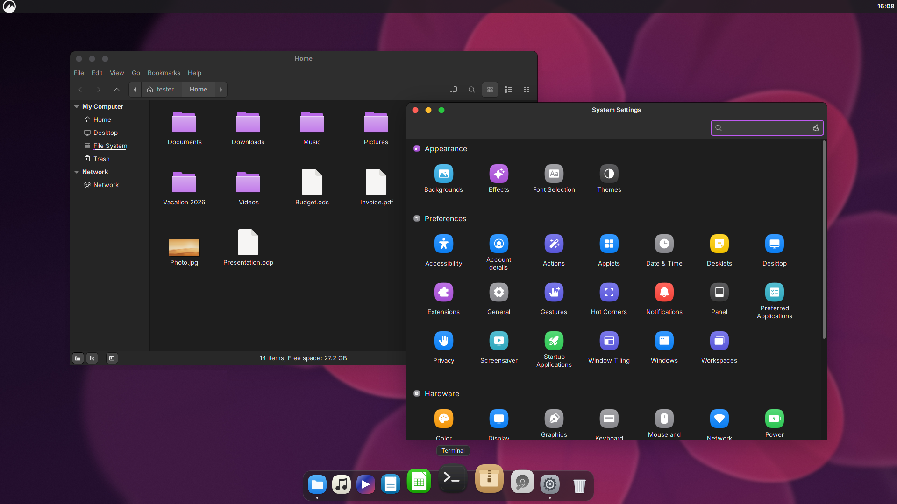
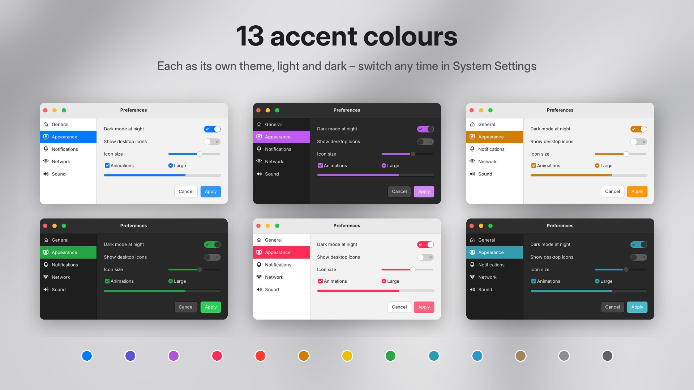
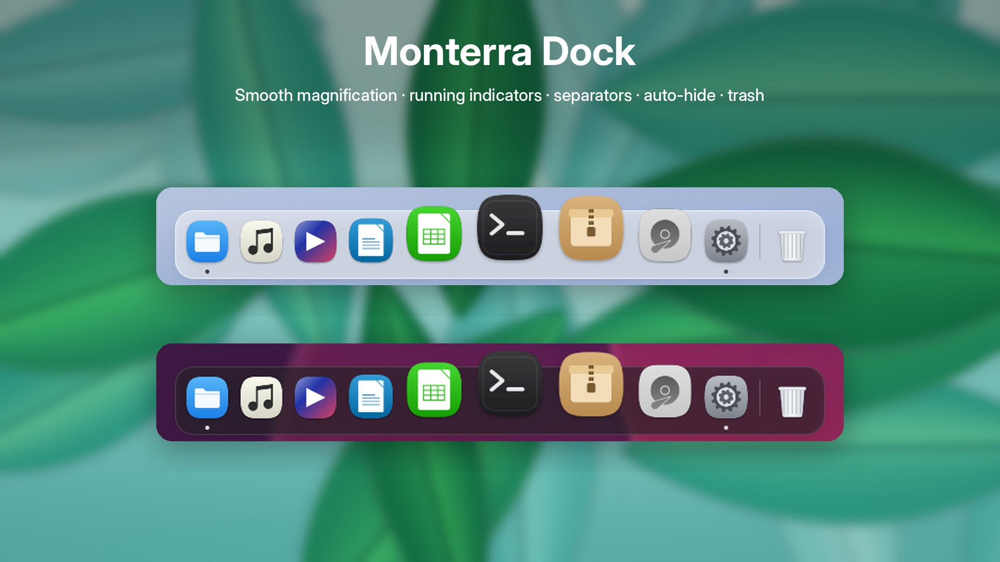
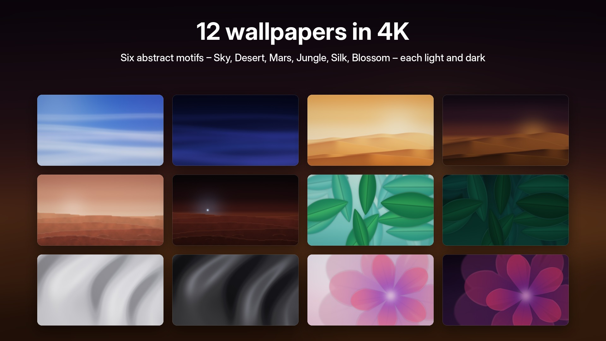
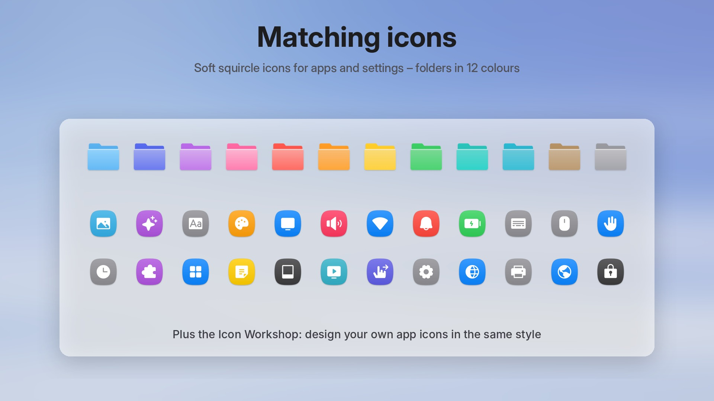

# Monterra

**A clean, elegant look for Linux Mint Cinnamon** – light and dark, with a dock, traffic-light window buttons, 13 accent colours, matching icons, cursors, wallpapers and more.

Made for **Linux Mint 22.3 (Cinnamon 6.6)**, prepared for Mint 23 / Cinnamon 6.8.
🇩🇪 Deutsche Anleitung: [README.de.md](README.de.md) · 🇪🇸 El instalador también habla español.



## Install

1. Download the latest **Monterra ZIP** from [Releases](../../releases) (or `git clone` this repository).
2. Unzip it, open a terminal in the folder and run – **without** `sudo`:

   ```bash
   bash setup.sh
   ```

The installer asks for your language first (Deutsch · English · Español), then lets you choose light or dark, panel and dock layout, wallpaper and accent colour (with previews), window-button size and optional extras. Your previous settings are backed up; **“Remove Monterra completely”** in the same installer restores everything.

The installer opens a Monterra-styled assistant with previews. Options: `bash setup.sh --classic` (separate dialogs as before) · `--text` (questions in the terminal) · `--lang=en`

## What you get

| | |
|---|---|
| **Themes** | `Monterra` and `Monterra-Dark` for GTK 2/3/4, libadwaita and the Cinnamon desktop – built on Linux Mint's own Mint-Y, so every app and dialog keeps working |
| **Accent colours** | 13 system colours, each as its own theme (`Monterra-Green`, `Monterra-Dark-Green` …), switchable any time in *System Settings → Themes* – desktop, folders, Firefox and Thunderbird follow automatically |
| **Windows** | traffic-light buttons (size adjustable), rounded corners, soft shadows; optional: remember window size and position per app |
| **Monterra Menu Bar** | top menu bar with logo menu (search, system settings, edit menu, sleep, restart, shut down, log out) and one drop-down per app category that opens on hover; right-click an app to add it to the dock or open its properties |
| **Monterra Dock** | magnifying dock with running indicators, drag & drop, freely placeable separators, auto-hide |
| **Icons & cursor** | squircle app icons, blue folders in 12 colours, Monterra cursor; *Icon Workshop* to design your own icons |
| **Wallpapers** | 6 abstract 4K motifs (Sky, Desert, Mars, Jungle, Silk, Blossom), each light and dark |
| **More** | notifications, Alt+Tab switcher, lock screen, login screen, boot splash, Firefox and Thunderbird looks |

<p>
  
  
</p>






## Tips

- **4K screens:** set the monitor scaling to 200 % in *Display* settings, or run `gsettings set org.cinnamon.desktop.interface scaling-factor 2`.
- **Update just the menu bar:** `bash tools/menubar.sh` · remove it: `bash tools/menubar.sh --remove`
- **Update just the dock:** `bash tools/dock.sh`, then press Alt+F2, type `r`, Enter.
- **Change accent colour from the terminal:** `bash tools/accent-color.sh green`

## Building from source

Everything needed to rebuild the themes, icons, cursors and wallpapers is in [`source/`](source/README.txt). The themes are generated from [linuxmint/mint-themes](https://github.com/linuxmint/mint-themes) with a small Monterra layer on top.

## Licence and credits

- Monterra is released under the **GNU GPL v3** (see [LICENSE](LICENSE)), as it is based on **Mint-Y** by the Linux Mint team (GPL-3.0).
- Some icons and the Icon Workshop symbols are based on **[Phosphor Icons](https://phosphoricons.com)** (MIT licence, see `source/third_party/`).

*Monterra is an independent community project and is not affiliated with or endorsed by Linux Mint.*
